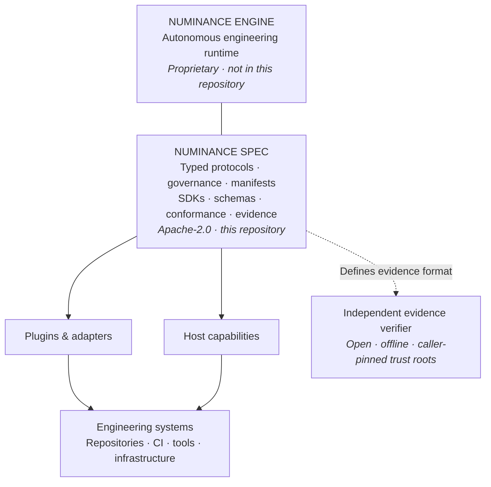

<p align="center">
  <picture>
    <source media="(prefers-color-scheme: dark)" srcset=".github/assets/numinance-lockup-horizontal-bone.svg">
    
  </picture>
</p>

<h1 align="center">Numinance</h1>

<h2 align="center">The world's first independently verifiable autonomous AI software engineer.</h2>

<p align="center">
  <strong>Beyond code generation. Beyond assistance. Autonomous engineering.</strong>
</p>

<p align="center">
  Self-hosted by design &nbsp;·&nbsp; Governed by policy &nbsp;·&nbsp; Verifiable by evidence
</p>

<p align="center">
  <a href="#why-this-exists">Why Numinance</a> ·
  <a href="#what-is-in-this-repository">Explore the protocol</a> ·
  <a href="#get-started">Get started</a> ·
  <a href="#evidence-you-can-verify">Verify evidence</a>
</p>

---

**The next leap in software engineering isn't generating more code. It's making engineering autonomous—and accountable.**

Imagine assigning an engineering objective instead of writing the next prompt. A system that can understand an existing codebase, reason about its architecture, plan a change, implement it, run checks, seek independent review, and move it toward production—all within permissions you define.

Now imagine being able to **verify what it did without having to trust what it says it did.**

That is the ambition behind **Numinance**: a self-hosted autonomous AI software engineer designed to carry work from intent to verified change, with authority enforced outside the model and cryptographic evidence that can be examined independently.

This repository is where that ambition meets an open contract.

**`numinance-spec`** is the Apache-2.0 protocol and developer ecosystem around Numinance: vendor-neutral capability contracts, Protobuf schemas, Go/Python/TypeScript SDKs, official integrations, conformance suites, the `numi` CLI, and an independent offline evidence verifier.

**The intelligence engine is proprietary. The interfaces, integration standards, and evidence verification tools are open.**

> [!NOTE]
> **Project status: pre-alpha.** This repository exposes the public specification and supporting implementation work—not a runnable distribution of the Numinance engine. Interfaces may change before their first tagged release; see [Versioning](VERSIONING.md).

## Why this exists

Autonomy without a clear execution boundary is difficult to reason about.

A coding assistant can propose a change. An autonomous engineering system may act on repositories, test environments, external services, and eventually deployment pipelines. Once a system can act, the questions become architectural:

- **Authority:** Who initiated this action, under what identity, and with which permissions?
- **Scope:** Which capabilities can be invoked, in which environment, and at what risk level?
- **Compatibility:** Can an independently developed integration implement the same contract?
- **Evidence:** Can someone outside the engine check the record of what happened?

Numinance treats those questions as interface design—not as details left to an agent's prompt.

The result is an intentional separation between **the intelligence that decides what to attempt** and **the public contract through which external capabilities are described, invoked, and verified**.

## The boundary



The diagram describes the **public integration boundary**, not the private engine's internal architecture.

The engine can evolve. Integrations should depend on **versioned, explicit contracts** rather than its implementation details.

## What is in this repository

| Surface | What it gives you |
| --- | --- |
| **Protocol definitions** | Protobuf contracts for plugins, hosts, ports, types, events, evidence, and configuration kinds. |
| **Governance annotations** | Risk and execution semantics declared on protocol surfaces, rather than inferred from prose. |
| **SDKs** | Go, Python, and TypeScript SDK source and generated clients. |
| **Official plugins** | Reference integrations, including GitHub SCM, GitHub Actions CI, and verification providers. |
| **Conformance** | Test vectors and suites for interoperable implementations of published ports and evidence formats. |
| **Evidence specification** | Canonical forms, signed records, hash chains, export bundles, transparency-log proofs, and verification rules. |
| **`numi` CLI** | Public tooling for configuration schema validation, version inspection, and offline evidence verification. |
| **RFCs and governance** | Public rules for compatibility, changes, and the evolution of the contract. |

### A contract, not a model wrapper

The protocol is designed around engineering capabilities and accountability. It describes *what an integration does*, *the context in which it is invoked*, *the constraints that apply*, and *the result and evidence it returns*.

It does **not** require integrations to know how Numinance plans, reasons, or selects coding agents internally.

## Get started

Choose the part of the contract you want to work with.

| I want to… | Start here |
| --- | --- |
| Understand what can change and when | [Versioning policy](VERSIONING.md) and [Governance](GOVERNANCE.md) |
| Implement a plugin or port | [`proto/numinance/plugin/`](proto/numinance/plugin/) and [`proto/numinance/ports/`](proto/numinance/ports/) |
| Explore official integrations | [`plugins/official/`](plugins/official/) and [`plugins/examples/`](plugins/examples/) |
| Use the SDKs | [`sdk/go/`](sdk/go/), [`sdk/python/`](sdk/python/), [`sdk/typescript/`](sdk/typescript/) |
| Validate configuration kinds | [CLI documentation](cli/README.md) and [`schemas/examples/`](schemas/examples/) |
| Verify an evidence export | [Evidence specification](docs/evidence/README.md) and [Go verifier](sdk/go/evidenceverify/README.md) |
| Check interoperability | [`conformance/`](conformance/) |
| Understand a design decision | [`rfcs/`](rfcs/) |

### Try the open CLI

From a checkout of **this specification repository**, with the Go version required by [`go.mod`](go.mod):

```bash
# Inspect the public CLI version.
go run ./cli/numi version

# Schema-check example configuration documents.
go run ./cli/numi validate --files schemas/examples/SDLCProfile
```

The `--files` command performs **schema and loader validation only**. It does not resolve a complete repository profile, enforce customer policy floors, or substitute for engine-side validation. The open build makes that distinction explicit; see [`cli/README.md`](cli/README.md).

## Evidence you can verify

**An autonomous run should leave more than a confident summary.**

Numinance defines `evidence/v1`: a documented export format for recording and independently checking evidence associated with a change. The public specification covers canonical encoding, record hashes, signed records, hash-linked chains, export manifests, transparency-log checkpoints and proofs, and verification outcomes.

The open Go verifier is designed to operate **offline**, without the private Numinance engine or network access.

```text
docs/evidence/                 Normative format and verification rules
schemas/evidence/v1/          Machine-readable export schemas
conformance/evidence/v1/      Golden vectors and expected results
sdk/go/evidenceverify/        Independent Go verifier
rfcs/0003-evidence-chain-format-v1.md
```

The CLI exposes the verifier as:

```bash
numi evidence verify
```

A result reaches **`verified`** only when the caller independently pins the required runner key(s), transparency-log key, and log origin. Trusting keys supplied by the export itself is not equivalent to independent verification.

Cryptographic verification establishes properties of an evidence export under the selected trust assumptions. It does **not**, by itself, prove that a generated change is correct, that an external system behaved honestly, or that every relevant event was captured. See [verification rules and limitations](docs/evidence/verification.md).

This distinction is deliberate: **the system generating evidence should not be the only authority deciding whether that evidence is trustworthy.**

## Protocol at a glance

<details>
<summary><strong>Core packages, types, and extension model</strong></summary>

<br>

| Package | Purpose |
| --- | --- |
| `numinance.annotations.v1` | Governance options on RPCs and fields, including `RiskClass` and `ExecMode`. |
| `numinance.types.v1` | Canonical shared types: `PrincipalKind`, `ResidencyClass`, `TrustClass`, `AutonomyLevel`, `ChangeState`, `Digest`, `Reference`. |
| `numinance.plugin.v1` | `PluginService.Invoke`, the host-facing `HostService`, invocation `Envelope`, `ActionContext`, `ActionResult`, `Diagnostic`, and extension `Manifest`. |
| `numinance.kinds.v1` | Typed configuration kinds with `apiVersion`, `kind`, `metadata`, `spec`, and `extensions`. |
| `numinance.ports.*.v1` | Vendor-neutral engineering capability contracts, with their conformance expectations. |
| `numinance.evidence.v1` / `numinance.events.v1` | Evidence and event wire contracts. |

The plugin, evidence, events, and ports packages use the shared `types/v1` definitions. Duplicating those shared wire types locally is prohibited.

A plugin declares its capabilities and intended actions through its manifest. A host invokes the plugin through the typed protocol. The private engine's internal reasoning strategy is not part of this surface.

JSON Schemas and examples for configuration kinds live in [`schemas/`](schemas/); generated SDK code is committed under `sdk/*/gen/`, so a source checkout does not require code generation merely to use those clients.

</details>

## Principles

**Explicit authority.** Identity, capability, risk, and execution semantics should be expressed in contracts that implementations can inspect.

**One concept, one wire type.** Shared meanings should not drift between plugins, events, ports, and evidence records.

**Interoperability by conformance.** Compatibility is demonstrated with testable behavior—not just claimed in documentation.

**Independent evidence.** Evidence exports should be checkable without access to the private engine, using trust roots chosen by the verifier.

**Versioned evolution.** Changes follow [the published compatibility policy](VERSIONING.md), with RFC review for changes that exceed the contract-additive class.

## Repository map

```text
numinance-spec/
├── proto/                Public Protobuf contracts
├── schemas/              Configuration and evidence JSON Schemas
├── sdk/                  Go, Python, and TypeScript SDKs
├── plugins/
│   ├── official/         Official capability providers and adapters
│   └── examples/         Reference plugin examples
├── conformance/          Port and evidence conformance suites
├── cli/                  Open numi CLI entry point and documentation
├── docs/evidence/        Evidence/v1 normative documentation
├── rfcs/                 Proposals and recorded protocol decisions
├── VERSIONING.md         Compatibility and release policy
├── GOVERNANCE.md         Contribution and decision process
└── LICENSE               Apache License 2.0
```

## Open specification. Private intelligence.

The distinction matters:

- **Open under Apache-2.0:** the contracts, schemas, SDKs, official plugins, conformance material, evidence specification and verifier, and public `numi` CLI.
- **Not included here:** Numinance's proprietary autonomous engineering engine, its internal orchestration, and its runtime distribution.

This repository is not an open-source release of the autonomous engineer itself. It is the open contract developers can build against, test, and inspect.

## Development and contributions

Numinance is in **pre-alpha**. The specification and implementation surfaces are under active development; before the first tag, do not assume a stable released contract. [Versioning](VERSIONING.md) defines the release and compatibility rules.

The most useful contributions are the ones that make the public boundary more precise: ambiguous semantics, missing conformance cases, stronger verification tests, SDK ergonomics, and independently useful plugins.

Changes beyond `contract-additive` go through the [RFC process](GOVERNANCE.md), including a minimum 14-day public comment period before acceptance. Contributions use the **Developer Certificate of Origin (DCO)** with `Signed-off-by`; no CLA is required.

See [Governance](GOVERNANCE.md) and the [RFC template](rfcs/0000-template.md) before proposing a contract-level change.

## License

The public specification and its included code are released under the [Apache License 2.0](LICENSE). Numinance's proprietary engine is **not** covered by that license.

---

<p align="center"><strong>The future of software engineering should be autonomous. Trust should never be automatic.</strong></p>
<p align="center">
  Follow the open foundation of independently verifiable autonomous engineering.<br>
  <strong>Star this repository</strong> to watch the protocol evolve—and help define the standards behind it.
</p>
